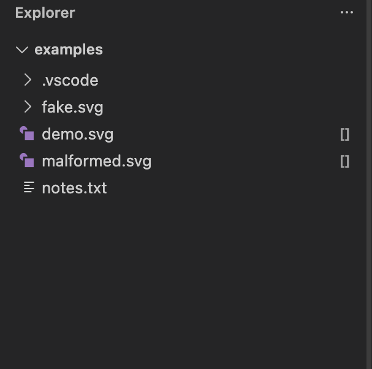
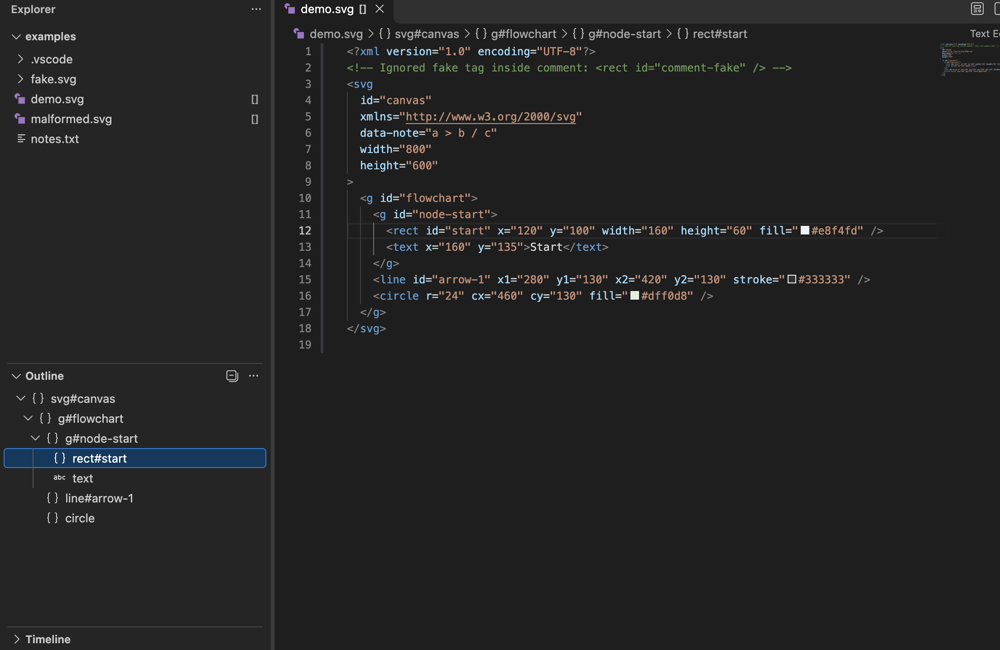

# SVG Explorer & Outline 扩展说明与设计分析

## 1. 环境要求与启动步骤

### 1.1 环境要求
- Node.js >= 18（已验证于 Node v24）
- Visual Studio Code >= 1.85.0

### 1.2 安装、编译与单元测试
```bash
npm install
npm run compile
npm test
```

### 1.3 在 VSCode 中运行与调试
1. 使用 VSCode 打开仓库根目录 `/Users/lazy/svg-vscode-extension`。
2. 按 `F5`（或点击左侧 **Run and Debug** → 选择 **Run Extension**），系统会自动执行 `npm run compile` 并打开新的 **Extension Development Host** 窗口。
3. 在新窗口中打开本仓库的 `examples/` 目录进行验证：
   - **A.1 Explorer 文件标记**：左侧资源管理器中 `demo.svg` 与 `malformed.svg` 右侧显示 `[]` 标记；`notes.txt` 与目录 `fake.svg/` 不显示标记；磁盘文件名与内容均未被修改。
   - **A.2 Outline 大纲与定位**：
     - 打开 `examples/demo.svg`（本仓库已在 `examples/.vscode/settings.json` 中配置 `"workbench.editorAssociations": { "*.svg": "default" }`，确保新版 VSCode 直接以原生 **Text Editor** 打开 `.svg`；若在其他工作区遇到默认打开为图片预览，请点击右上角 `Text Editor v` → **Configure default editor for '*.svg'... → Text Editor**，切勿仅做一次性 `Open With`，否则 VSCode 1.144 点击 Outline 时内部 `openEditor` 仍会按默认图片预览解析而无法跳转光标）；
     - 展开左侧 **Outline** 视图，可见 `svg#canvas → g#flowchart → (g#node-start → (rect#start, text), line#arrow-1, circle)` 嵌套树；
     - 点击任意节点（如 `rect#start` 或 `text`），右侧编辑器光标精准定位到对应元素的开始标签；
     - 在编辑器中修改 `id` 或增删元素，Outline 自动实时更新；
     - 打开 `examples/malformed.svg` 或在 `demo.svg` 中删去 `</svg>`，Outline 安全清空且扩展不崩溃；补回标签后大纲立即恢复。

> 运行效果图见第 2 节。

---

## 2. 原生 VSCode 行为对照与真实运行效果

在未启用本扩展（且无第三方 XML/SVG 语言插件）的原生 VSCode 中：
- **Explorer**：`.svg` 文件旁没有附加标识，仅显示普通文件名。
- **Outline**：打开 `.svg` 文件时 VSCode 默认归类为 `xml` 语言，但原生不提供符号解析，Outline 面板显示 `No symbols found in document 'demo.svg'`。

启用本扩展后，Explorer 自动展示 `[]` 标记，Outline 自动呈现完整嵌套元素树并支持点击跳转源码：

### A.1 Explorer 文件标记效果


*图 1：`demo.svg` 与 `malformed.svg` 右侧显示 `[]` 标记；普通文本文件 `notes.txt`、普通目录 `.vscode` 及同名 `.svg` 目录 `fake.svg` 均无标记，原文件名和文件内容保持不变。*

### A.2 SVG 原生大纲与源码定位效果


*图 2：左下角 Outline 完整展示 `svg#canvas → g#flowchart → g#node-start → (rect#start, text)` 等嵌套层级，无 `id` 元素显示标签名（`text`、`circle`）；点击 `rect#start` 后编辑器精准定位并高亮第 12 行源码。*

---

## 3. VSCode 与插件的职责及注册调用机制

### 3.1 职责划分

| 参与方 | 核心职责 |
| :--- | :--- |
| **VSCode（宿主框架）** | 解析 `package.json` 扩展清单；在 `onStartupFinished` 时机激活扩展；管理 Explorer 与 Outline 的 UI 渲染、滚动定位与事件防抖；通过 `CancellationToken` 控制过时请求取消；在扩展停用时统一释放 `Disposable`。 |
| **本扩展（插件）** | 在 `src/extension.ts` 的 `activate(context)` 中向宿主注册扩展点实现；通过 `SvgFileRule` / `SvgOutlineParser` 完成与 UI 无关的领域判定与解析；通过 Provider 适配层返回只读数据模型（`FileDecoration`、`DocumentSymbol[]`），**不直接操作任何 UI DOM**。 |

### 3.2 注册与反向回调流程（控制反转 IoC）

1. **静态发现**：VSCode 启动时读取 `package.json` 中的 `activationEvents: ["onStartupFinished"]` 与 `main: "./out/extension.js"`。
2. **激活与注册**：工作区启动完成后，VSCode 调用 `activate(context)`；插件依次调用：
   - `vscode.window.registerFileDecorationProvider(decorationProvider)`
   - `vscode.languages.registerDocumentSymbolProvider([{ pattern: '**/*.[sS][vV][gG]' }], symbolProvider)`
   并将两个返回的 `Disposable` 推入 `context.subscriptions`。
3. **运行时反向回调**：
   - Explorer 渲染目录条目时，VSCode 回调 `provideFileDecoration(uri, token)`，取得 `FileDecoration('[]', 'SVG file')` 后由宿主叠加绘制在文件名右侧；
   - 打开或编辑 `.svg` 文件时，VSCode 回调 `provideDocumentSymbols(document, token)`，取得嵌套 `DocumentSymbol[]` 后由宿主渲染 Outline 树并绑定点击跳转行为。
4. **卸载回收**：扩展停用或窗口关闭时，VSCode 自动调用 `context.subscriptions` 中全部 `Disposable.dispose()`。

---

## 4. 文件装饰与经典 Decorator / Adapter 模式的对比分析

### 4.1 与经典 Decorator（装饰器）模式的对应与差异

- **设计意图相似**：二者都遵循开闭原则（OCP），在不修改目标对象本身（原文件名、文件内容及 Explorer 基础渲染逻辑不变）的前提下，动态为条目附加额外展示信息（`[]` 标记）。
- **结构与调用关系存在本质差异**：
  1. **接口关系不同**：经典 GoF Decorator 要求装饰器与被装饰组件实现**同一个抽象接口**；而 `SvgFileDecorationProvider` 并未实现 Explorer 文件节点接口，仅实现“按 `Uri` 查询装饰描述符”的提供者接口。
  2. **对象组合不同**：经典 Decorator 通过递归持有被装饰对象的引用（`wrappee`）层层包装；而 `SvgFileDecorationProvider` **不持有任何 Explorer 节点对象**，仅根据宿主传入的 `Uri` 产出只读数据对象 `FileDecoration`。
  3. **调用方向不同**：经典 Decorator 由外层装饰器主动把请求转发给内层组件；VSCode 中则是**宿主框架居中调度（IoC）**——Explorer 主动向所有注册的 `FileDecorationProvider` 查询并聚合装饰结果后统一绘制。
- **小结**：`FileDecorationProvider` 在视觉效果上是“装饰”，但在结构上属于 **扩展点提供者（Provider）+ 数据描述符合成**，而非经典递归包裹式 Decorator。

### 4.2 与经典 Adapter（适配器）模式的对应与差异

- **对应关系（对象适配器）**：
  - **Target（目标接口）**：VSCode 宿主定义的 `vscode.FileDecorationProvider` 与 `vscode.DocumentSymbolProvider`。
  - **Adaptee（被适配者）**：与 `vscode` 运行时零耦合的纯领域模块 `SvgFileRule`（配合 `FileStatReader`）与 `SvgOutlineParser`（产出字符偏移模型 `SvgOutlineNode`）。
  - **Adapter（适配器）**：`SvgFileDecorationProvider` 与 `SvgDocumentSymbolProvider` 通过**对象组合**持有领域对象，负责把领域层判定结果与偏移量树转换为宿主所需的 `vscode.FileDecoration` 与 `vscode.DocumentSymbol`（含 `document.positionAt` 行列转换与 `SymbolKind` 映射）。
- **差异**：经典 Adapter 多用于事后桥接两个已有且不兼容的接口；VSCode 的 Provider 接口是宿主事前设计的标准扩展契约。通过显式拆分 `src/core/` 与 `src/providers/`，本扩展在实现契约的同时，严格落地了对象适配器边界，使核心逻辑得以脱离 VSCode 宿主独立测试。

---

## 5. 自动化测试覆盖

运行 `npm test` 执行全部 5 组单元测试，覆盖所有核心功能与边界条件：
- `test/svgFileRule.test.ts`：大小写 `.svg`、非 `.svg` 零 I/O 短路、裸 `.svg` 隐藏文件排除、`.svg` 同名目录排除、`stat` 异常兜底。
- `test/svgFileDecorationProvider.test.ts`：普通文件、指向文件的符号链接、目录、指向目录的符号链接、忽略 scheme、取消令牌、文件系统异常。
- `test/svgOutlineParser.test.ts`：多层嵌套、顺序保真、有/无/空 `id`、单双引号与空白、命名空间标签、XML 声明/DOCTYPE 内部子集/注释/CDATA、多行属性含 `>` 与 `/`、多根节点、18 类残缺/非法 XML 容错、编辑破坏与恢复、千行文档性能验证。
- `test/svgDocumentSymbolProvider.test.ts`：`标签名#id` 与 `标签名` 命名、`SymbolKind` 映射、LF/CRLF 行列偏移、`selectionRange ⊆ range` 不变量、取消令牌与残缺输入。
- `test/extension.test.ts`：`package.json` 激活清单检查、`activate()` 双 Provider 注册与 `Disposable` 托管、`deactivate()` 清理。
