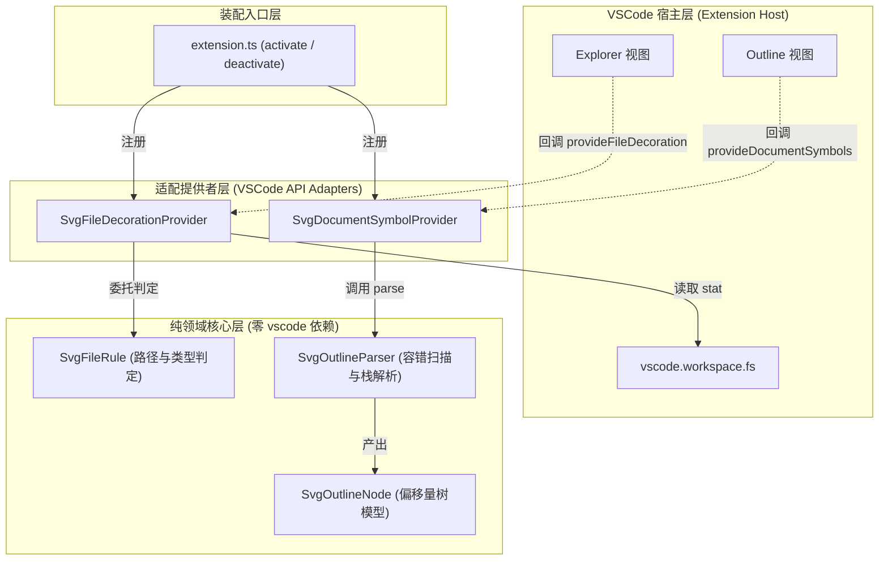
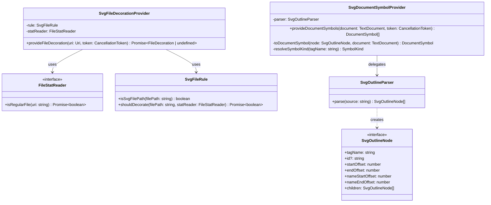
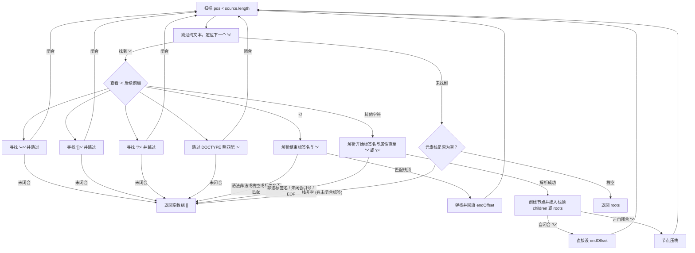
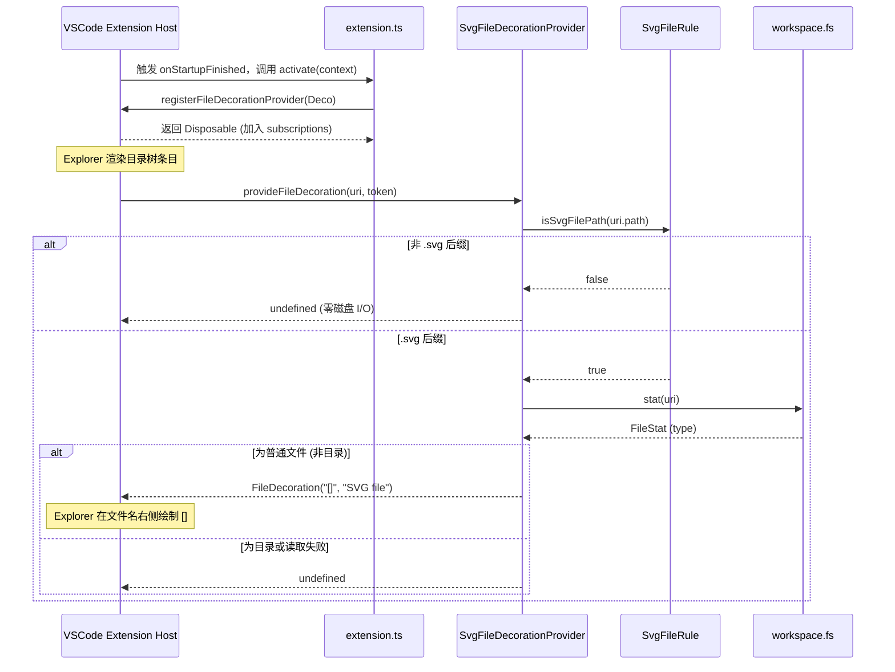
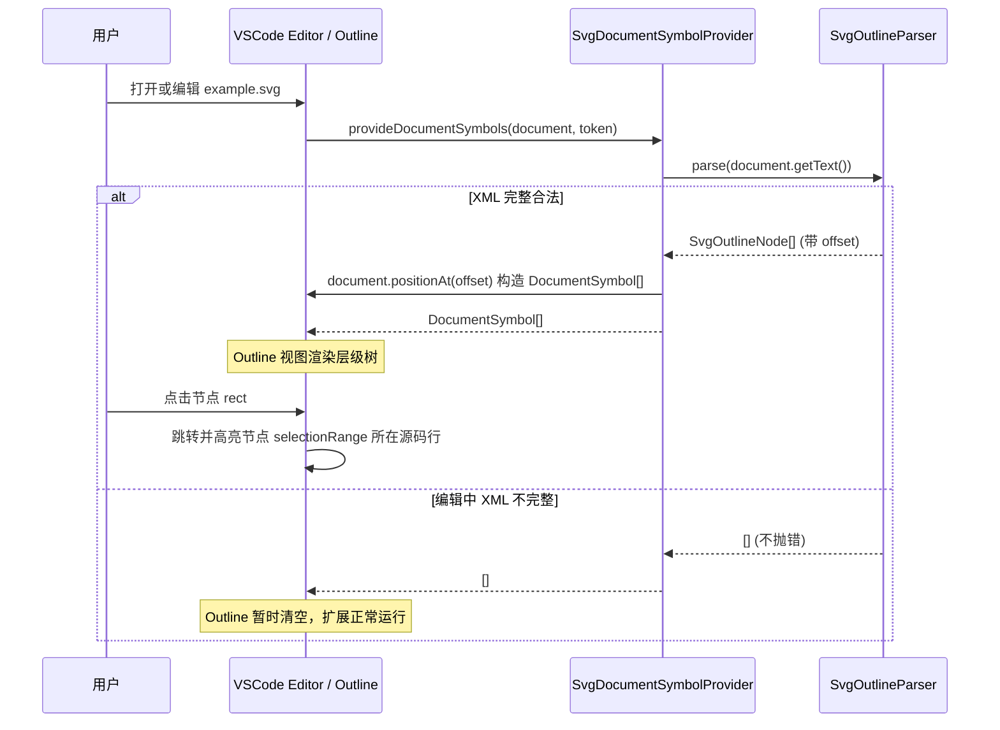

# VSCode SVG 扩展 — 开发设计文档

本文档对应 [vscode_plugin_requirements.md](./requirements.md)，定义 VSCode SVG 扩展的工程架构、核心模块设计、算法细节、测试策略与开发实施计划。

---

## 1. 总体架构设计

### 1.1 分层架构与解耦原则

为保证代码结构清晰、面向对象特征明确且**核心逻辑脱离 VSCode 运行时即可独立单测**，项目采用三层架构：



**核心设计原则**：
1. **宿主与领域隔离**：`src/core/` 下严禁 `import * as vscode from 'vscode'`，所有路径判定、XML 扫描、栈解析逻辑均为纯 TypeScript，单测毫秒级执行。
2. **对象适配器落地**：`SvgDocumentSymbolProvider` 与 `SvgFileDecorationProvider` 通过组合持有领域对象，将领域层的原始结果适配为 VSCode 要求的 `vscode.DocumentSymbol` 与 `vscode.FileDecoration`。
3. **单一组合根**：`src/extension.ts` 仅负责实例化对象、向 VSCode 注册 Provider 并将 `Disposable` 交给 `context.subscriptions` 管理，不包含任何业务解析逻辑。

---

### 1.2 仓库目录结构

```text
vscode-svg-extension/
├── .vscode/
│   ├── launch.json                      # F5 启动 Extension Development Host 配置
│   └── tasks.json                       # 启动前自动执行 npm run compile
├── package.json                         # 扩展清单、依赖与脚本
├── tsconfig.json                        # TypeScript 严格模式配置
├── vitest.config.ts                     # 单元测试配置
├── src/
│   ├── extension.ts                     # 入口：activate / deactivate
│   ├── core/
│   │   ├── svgFileRule.ts               # SVG 文件路径判定规则与文件系统抽象接口
│   │   ├── svgOutlineNode.ts            # 大纲节点领域模型（字符偏移量）
│   │   └── svgOutlineParser.ts          # 轻量容错 SVG/XML 扫描与栈解析器
│   └── providers/
│       ├── svgFileDecorationProvider.ts # A.1：FileDecorationProvider 实现
│       └── svgDocumentSymbolProvider.ts # A.2：DocumentSymbolProvider 实现
├── test/
│   ├── svgFileRule.test.ts              # 路径过滤与文件/目录/异常替身测试
│   ├── svgOutlineParser.test.ts         # 嵌套、id、特殊语法、全套残缺 XML 单测
│   └── svgDocumentSymbolProvider.test.ts# offset→Range 转换与 Symbol 树映射单测
├── examples/
│   ├── demo.svg                         # 标准示例（多层嵌套、有/无 id、注释）
│   └── malformed.svg                    # 异常演示用样例（可选，测试不崩溃）
└── docs/
    ├── README.md                        # 安装启动步骤、运行截图与架构说明
    └── images/
        ├── vscode-svg-badge.png
        └── vscode-svg-outline.png
```

---

## 2. 扩展清单设计（`package.json`）

关键字段约束如下：

```json
{
  "name": "svg-explorer-outline",
  "displayName": "SVG Explorer & Outline",
  "description": "Adds [] badge for .svg files in Explorer and provides native Outline navigation.",
  "version": "0.1.0",
  "engines": {
    "vscode": "^1.85.0"
  },
  "categories": ["Other"],
  "activationEvents": [
    "onStartupFinished"
  ],
  "main": "./out/extension.js",
  "scripts": {
    "compile": "tsc -p ./",
    "watch": "tsc -watch -p ./",
    "test": "vitest run",
    "test:watch": "vitest"
  }
}
```

> [!IMPORTANT]
> **`activationEvents` 必须使用 `"onStartupFinished"`**：Explorer 视图在用户尚未打开任何 `.svg` 文件时就需要展示 `[]` 标记；若依赖 `onLanguage` 则冷启动不生效，若使用 `"*"` 会拖慢 VSCode 启动。`"onStartupFinished"` 是官方推荐方案。

---

## 3. 核心类设计与接口契约

### 3.1 类关系图



---

### 3.2 模块一：文件标记（`svgFileRule.ts` & `svgFileDecorationProvider.ts`）

#### 领域规则：`SvgFileRule`
- **`isSvgFilePath(filePath: string): boolean`**
  - 提取路径最后一段文件名 `baseName`（兼容 `/` 与 `\`）。
  - 规则：以 `.svg` 结尾（大小写不敏感），且 `baseName.length > 4`（排除名为 `.svg` 的无主文件名隐藏文件）。
  - 纯字符串计算，**不触发任何文件系统 I/O**。
- **`shouldDecorate(filePath: string, statReader: FileStatReader): Promise<boolean>`**
  1. 先调用 `isSvgFilePath(filePath)`，不满足直接返回 `false`。
  2. 调用 `statReader.isRegularFile(filePath)` 检查目标是否为非目录文件。
  3. 内部 `try/catch` 兜底，遇到无权限或已删除文件时返回 `false`。

#### VSCode 适配：`SvgFileDecorationProvider`
- 封装 `vscode.workspace.fs.stat(uri)` 实现 `FileStatReader`：
  ```ts
  const stat = await vscode.workspace.fs.stat(uri);
  // 只要包含 Directory 标志（含目录与指向目录的符号链接）一律排除
  const isDirectory = (stat.type & vscode.FileType.Directory) !== 0;
  const isFile = (stat.type & vscode.FileType.File) !== 0;
  return !isDirectory && isFile;
  ```
- `provideFileDecoration(uri, token)`：
  1. 若 `token.isCancellationRequested`，直接返回 `undefined`。
  2. 仅处理本地文件或常规带路径 scheme（跳过非文件虚拟 scheme 导致无意义 stat 异常，异常也会被捕获兜底）。
  3. 若 `await this.rule.shouldDecorate(...)` 为 `true`，再次检查 `token.isCancellationRequested`，返回：
     ```ts
     return new vscode.FileDecoration('[]', 'SVG file');
     ```
  4. 否则返回 `undefined`。

> [!TIP]
> `vscode.FileDecoration.badge` 官方硬限制最多 **2 个字符**，`[]` 恰好 2 字符，安全合规。

---

### 3.3 模块二：领域大纲模型（`svgOutlineNode.ts`）

```ts
export interface SvgOutlineNode {
  /** 元素标签名，如 "svg"、"g"、"rect"、"svg:rect" */
  readonly tagName: string;
  /** 提取到的非空 id 属性值（已 trim）；缺失或为空时为 undefined */
  readonly id?: string;
  /** 整个元素起始字符偏移（'<' 的索引，闭区间） */
  readonly startOffset: number;
  /** 整个元素结束字符偏移（闭合标签 '>' 之后的索引，开区间） */
  readonly endOffset: number;
  /** 开始标签名起始字符偏移（用于 selectionRange） */
  readonly nameStartOffset: number;
  /** 开始标签名结束字符偏移（用于 selectionRange） */
  readonly nameEndOffset: number;
  /** 直接子元素列表（保持源码顺序） */
  readonly children: SvgOutlineNode[];
}
```

**为什么在领域模型中存储字符偏移 `offset` 而不是 `(line, column)`？**
1. 解析器单遍线性扫描，无需额外维护换行表，彻底规避 Windows `\r\n` 与 macOS/Linux `\n` 混用导致的列偏移误差。
2. `vscode.TextDocument.positionAt(offset)` 原生使用二分查找将字符偏移 O(log N) 转为精确的 `vscode.Position`。
3. 天然保证 `startOffset <= nameStartOffset <= nameEndOffset <= endOffset`，确保构造出的 `selectionRange` **100% 严格包含于 `range` 内**，杜绝 VSCode 拒收符号树的风险。

---

### 3.4 模块三：容错 SVG/XML 解析器（`svgOutlineParser.ts`）

采用**单遍字符扫描 + 显式元素栈**（时间复杂度 $O(N)$，空间复杂度 $O(D)$，无正则回溯爆炸风险）。

#### 扫描与状态流转逻辑



#### 关键边界处理细则
1. **标签名合法字符**：首字符 `[A-Za-z_]`，后续字符 `[A-Za-z0-9_.:-]`（覆盖标准 SVG 标签及命名空间前缀如 `svg:rect`）。
2. **属性解析（核心防误判点）**：
   - 跳过空白字符后，若遇到 `>` 则开始标签正常结束；若遇到 `/>` 则标记自闭合结束；
   - 否则读取属性名 → 跳过空白 → 若紧跟 `=` 则跳过空白并强制期待 `"` 或 `'` → 扫描到对应的闭合引号（引号内部出现任意 `>`、`/`、`<` 均视为普通属性字符，绝不截断标签）；
   - 若到达文件末尾仍未找到闭合引号，判定为不完整 XML，直接返回 `[]`；
   - 当属性名精确等于 `id` 且当前节点尚未记录 `id` 时，取 `value.trim()`，非空则赋值给 `node.id`。
3. **DOCTYPE 内部子集处理**：跳过 `<!DOCTYPE ...>` 时同时跟踪单双引号与方括号深度 `[...]`，避免内部实体声明的 `>` 提前终止跳过。
4. **纯文本区非法 `<`**：一旦遇到 `<` 但后续字符既非上述合法构造又非合法标签名（例如 `<123` 或孤立 `<`），直接判定为非法/不完整 XML，返回 `[]`。
5. **多根节点策略（已确认）**：文档中存在多个配对完整的顶层元素时，正常按出现顺序返回全部顶层节点 `roots`；仅在栈非空、标签错配或语法残缺时返回 `[]`。
6. **异常保护**：`parse()` 外层不依赖外部抛错，所有异常路径统一以安全返回 `[]` 收口。

---

### 3.5 模块四：大纲提供者适配器（`svgDocumentSymbolProvider.ts`）

#### 注册选择器
```ts
const SVG_DOCUMENT_SELECTOR: vscode.DocumentSelector = [
  { pattern: '**/*.svg' },
  { pattern: '**/*.SVG' }
];
```
> [!NOTE]
> 使用 glob `pattern` 而非 `language: 'svg'`，可兼容原生 VSCode 默认将 `.svg` 识别为 `xml` 语言，也兼容用户已安装其他 SVG 语法高亮插件的情况。

#### 节点转换与图标映射
- **名称格式**：
  ```ts
  const displayName = node.id ? `${node.tagName}#${node.id}` : node.tagName;
  ```
- **`SymbolKind` 映射表**（提升 Outline 视觉辨识度）：
  - 容器类（`svg`、`g`、`defs`、`symbol`、`clipPath`、`mask`、`pattern`、`marker`、`a`）→ `vscode.SymbolKind.Namespace`
  - 文本类（`text`、`tspan`、`textPath`、`title`、`desc`）→ `vscode.SymbolKind.String`
  - 图形类（`rect`、`circle`、`ellipse`、`line`、`polyline`、`polygon`、`path`、`image`、`use`）→ `vscode.SymbolKind.Object`
  - 其他标签 → `vscode.SymbolKind.Struct`
- **取消检查**：在 `provideDocumentSymbols` 入口和递归转换前检查 `token.isCancellationRequested`，若已取消立即返回 `[]`。

---

### 3.6 模块五：扩展入口装配（`src/extension.ts`）

```ts
export function activate(context: vscode.ExtensionContext): void {
  const fileRule = new SvgFileRule();
  const decorationProvider = new SvgFileDecorationProvider(fileRule);
  const outlineParser = new SvgOutlineParser();
  const symbolProvider = new SvgDocumentSymbolProvider(outlineParser);

  const decorationDisposable =
    vscode.window.registerFileDecorationProvider(decorationProvider);
  const symbolDisposable =
    vscode.languages.registerDocumentSymbolProvider(
      [{ pattern: '**/*.svg' }, { pattern: '**/*.SVG' }],
      symbolProvider
    );

  context.subscriptions.push(decorationDisposable, symbolDisposable);
}

export function deactivate(): void {
  // 所有注册资源已交由 context.subscriptions 自动释放
}
```

---

## 4. 核心运行时序图

### 4.1 激活与 Explorer 文件标记流程



### 4.2 打开/编辑 SVG 触发大纲刷新与源码定位流程



---

## 5. 测试方案设计

### 5.1 自动化单元测试（Vitest）

| 测试文件 | 测试目标 | 必测用例集合 |
| :--- | :--- | :--- |
| `test/svgFileRule.test.ts` | `SvgFileRule`（注入 mock `FileStatReader`） | ① `example.svg` / `UPPER.SVG` / 嵌套路径返回 `true`；<br>② `.txt` / `.xml` / `.svg.bak` / `.svg` 返回 `false` 且**断言不调用 `statReader`**；<br>③ `dir.svg/`（目录）返回 `false`；<br>④ `statReader` 抛异常时安全返回 `false`。 |
| `test/svgOutlineParser.test.ts` | `SvgOutlineParser` | ① 单根与多层嵌套分组（`svg > g > g > rect + text`）；<br>② 有 `id`（双引号、单引号、`=` 两侧空白）、无 `id`、空 `id=""`；<br>③ 自闭合标签与成对标签混排、多行属性标签；<br>④ XML 声明、`DOCTYPE`、注释内伪标签、`CDATA`、属性值含 `>` 和 `/`；<br>⑤ 残缺输入：空串、半个标签 `<re`、未闭合属性引号、缺少结束标签、标签名错配、孤立闭合标签、未闭合注释 → 均返回 `[]` 且不抛错；<br>⑥ 模拟编辑序列：合法文本 → 破坏为残缺文本（`[]`）→ 修复后恢复（完整树）；<br>⑦ 精确校验 `startOffset / endOffset / nameStartOffset / nameEndOffset` 偏移量。 |
| `test/svgDocumentSymbolProvider.test.ts` | `SvgDocumentSymbolProvider`（轻量 mock `TextDocument`） | ① 验证节点命名 `标签名#id` 与 `标签名`；<br>② 验证 `range` 与 `selectionRange` 的行列转换（覆盖 `\n` 与 `\r\n`）及 `range.contains(selectionRange)`；<br>③ 验证 `token.isCancellationRequested = true` 时返回 `[]`。 |

### 5.2 手工联调与截图验证步骤（Extension Development Host）

1. 执行 `npm install && npm run compile && npm test`，确认全量单元测试通过。
2. 在 VSCode 中打开扩展仓库根目录，按 `F5` 启动 **Extension Development Host** 窗口。
3. 在新窗口中打开包含 `examples/demo.svg`、`notes.txt`、普通目录 `sub/` 以及测试目录 `fake.svg/` 的工作区：
   - **验证 A.1**：确认左侧 Explorer 仅 `demo.svg` 右侧显示 `[]`，截图保存。
   - **验证 A.2（正常）**：打开 `demo.svg`，展开左侧 Outline 视图，依次点击有 `id` 与无 `id` 节点，确认光标精准定位源码，截图保存。
   - **验证 A.2（编辑与容错）**：在编辑器中动态修改某个 `id`（观察 Outline 实时变化）→ 故意删除 `</svg>` 或敲入 `<re`（观察 Outline 清空且右下角无报错通知）→ 撤销恢复（观察 Outline 立刻恢复）。

---

## 6. 分步开发计划

| 阶段 | 任务内容 | 产出与完成判据 |
| :--- | :--- | :--- |
| **Step 1：工程脚手架** | 初始化 `package.json`、`tsconfig.json`、`vitest.config.ts`、`.vscode/launch.json` 与最小 `extension.ts` | `npm run compile` 零错误；按 `F5` 可正常拉起调试窗口 |
| **Step 2：A.1 文件标记** | 实现 `SvgFileRule`、`SvgFileDecorationProvider` 及 `svgFileRule.test.ts` | 单测全绿；调试窗口 Explorer 准确标记 `.svg` 文件并排除非 `.svg` 与目录 |
| **Step 3：A.2 大纲与解析器** | 实现 `SvgOutlineNode`、`SvgOutlineParser`、`SvgDocumentSymbolProvider` 及全套边界单测 | 单测覆盖全部 10 条验收项；调试窗口 Outline 嵌套、跳转、编辑刷新、残缺容错全部通过 |
| **Step 4：示例、截图与文档** | 完善 `examples/demo.svg`、截取运行效果图、编写 `docs/README.md`（安装步骤 + 架构与模式分析） | 按 README 步骤可在干净环境一键复现 |
